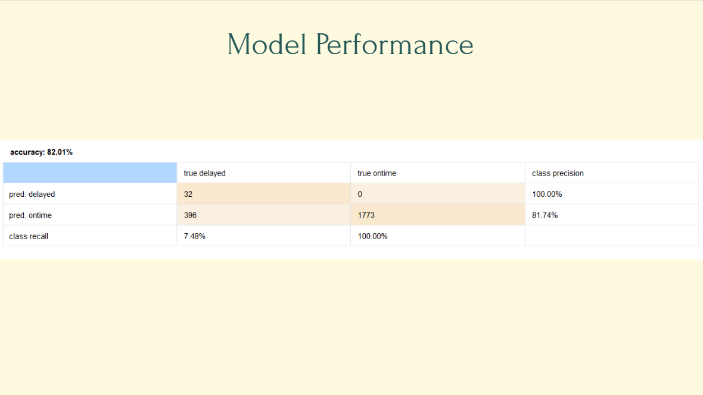
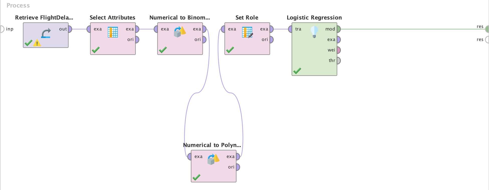
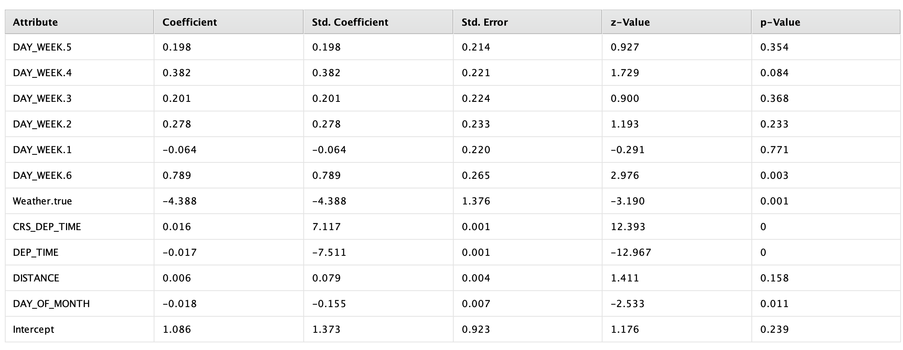

# FlightDelayAnalysis

**Course Team Project |  BANA 270: Intro to Business Analytics and AI**  
**March – June 2025** 
**Tools I used:** Altair AI Studio, PowerPoint

## 1. A Brief Overview of the Project

My team's Flight Project uses logistic regression to classify flights as delayed or on time and explore how predictions can support decisions for airline companies and their customers. The project applies predictive analytics to airline operations, examines implementation challenges, and proposes recommendations for operational improvement.

## 2. My Contribution

I developed business process recommendations and a management plan for applying the team's predictive model to airline operations.

- Suggested integrating model predictions into a scheduling dashboard through APIs or a decision support system (DSS), allowing teams to access results without interpreting complex model outputs.
- Recommended collaboration between operations, revenue management, and customer service teams to support departure scheduling decisions and passenger updates.
- Proposed performance metrics and feedback mechanisms to address departmental concerns about pricing, technical integration, implementation costs, and changes to existing workflows.
- Identified potential business benefits and proposed tracking on-time performance (OTP) to evaluate whether the model could support more reliable flight operations.

## 3. Project Description

My recommendations focus on how airline companies could use the model in daily operations:

- **Forecast and report delay risks:** Use APIs to connect model results to a dashboard or DSS database so teams can view predictions in one place.
- **Improve teamwork and flexibility:** Share delay-risk information across departments to coordinate operational decisions and passenger communications.
- **Track potential business value:** Consider automatic notifications through a phone or airline app, such as a delay-risk score for an upcoming flight. Monitor on-time performance, operating costs, and customer service outcomes to evaluate whether the tool benefits the airline.

## 4. Model Results

### Model Performance

### Model Workflow in Altair AI Studio

### Logistic Regression Results

## Project Presentation

[View the project presentation on Google Slides](https://docs.google.com/presentation/d/1qU1JsI16oOn5x3AjfHUJsuLUICSV2_Kz/edit?slide=id.p11#slide=id.p11)

## 5. What I Learned

Through this project, I was able to explore predictive analytics and learn how to use a regression model to inform business decisions in airline operations. I also gained a better understanding of how practical, data-driven solutions can address real problems across different departments.

Developing implementation recommendations helped me connect model outputs to operational needs, including scheduling decisions, cross-department collaboration, and passenger communication. I learned that a model's value depends not only on its predictions, but also on how clearly its results are communicated and how effectively they can be integrated into daily workflows.

Our main goal was to use delay predictions to support better departure scheduling, reduce delays, and improve the customer experience. This project helped me understand how predictive analytics could contribute to overall airline performance, while reinforcing the importance of evaluating model limitations and monitoring results before relying on it for operational decisions.

